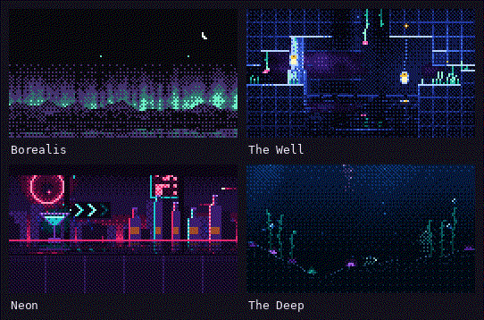

# dsh-live-pixel

[简体中文](README.zh.md)

Four animated pixel landscapes for DeepSeek Harness Web, drawn in real time with WebGL.



## Install and use

1. Install the first npm preview from the `next` tag. If your DSH Web server uses a different profile, replace `web` with its name. If you already use the local bundle, [remove it first](#migrate-from-the-local-build).

   ```sh
   dsh plugin --profile web add dsh-live-pixel@next
   ```

2. Restart the DSH Web server for that profile and refresh the page.
3. Open **Settings → Pixel themes** and choose a scene in the **Theme** dropdown. If text is hard to read over the scene, lower **Scene strength** or raise **Surface paper**.

### Remove

```sh
dsh plugin --profile web remove dsh-live-pixel
```

Restart the same DSH Web server and refresh the page after removal.

### Migrate from the local build

If you installed `@local/dsh-pixel-themes` as a bundle, remove it from the same profile before installing the preview. If you added it through a manual profile patch, remove that patch entry instead.

```sh
dsh plugin --profile web remove @local/dsh-pixel-themes
```

The new package reuses your theme and readability settings in the same browser and origin. To install a release tarball, pass its absolute path on the DSH host to `dsh plugin --profile web add` in place of `dsh-live-pixel@next`.

## Scenes

| Theme | Scene | Light and dark modes |
| --- | --- | --- |
| **Borealis** | Aurora, mountains and a lake under passing meteors. In light mode the scene becomes a two-ink risograph dawn. | Separate palettes |
| **The Well** | Hanging lamps, vines, a reflecting pool and falling stones at the bottom of a well. | One night palette |
| **Neon** | A bar window on a rainy night, with neon signs, rain streaks and bottles. | One night palette |
| **The Deep** | Shafts of light, a passing blue whale, jellyfish and kelp. | One night palette |

## Readability settings

| Control | Default | Effect |
| --- | --- | --- |
| Theme | Borealis | Switches the scene and rebuilds the canvas with the new shader |
| Scene strength | 100% | Lower it to veil more of the scene with the theme's paper colour |
| Surface paper | 93% | Paper opacity of cards, the composer, message bubbles and code blocks |
| Side columns | 90% | Paper opacity of the session list and the right panel |
| Bottom scrim | 60% | Strength of the fade above the composer |

Each theme keeps its own slider values. **Restore defaults** resets the current theme. DSH Web only syncs allowlisted settings namespaces, so this plugin stores its preferences in the current browser's `localStorage`.

## How it works

- **Shared WebGL engine.** A single fixed canvas (`z-index: -1`) draws one dither cell per 3 CSS pixels and targets 24 FPS. The engine manages sizing, frame scheduling, pointer easing and context loss recovery. It pauses animation while the tab is hidden and holds a still frame when reduced motion is enabled. Without WebGL, the UI keeps the theme palette without the animated scene.
- **Theme data.** Each theme supplies a GLSL fragment shader, light and dark shader palettes, semantic UI colours, localized labels and control defaults. The shaders choose their Bayer matrix. Neon uses 4×4 and the other scenes use 8×8.
- **UI tokens.** The semantic palette and paper opacity values feed 40+ `--dsw-alias-*` and `--dsw-specific-*` tokens for the app, including dialogs, menus and code blocks.
- **Readable layers.** The stylesheet clears the main containers, including `body`, `#root` and the conversation column, so the canvas shows through. Keeping `--dsw-alias-bg-base` opaque preserves neutral card fills, and the side columns keep their own paper fills. The paper veil (`--dsh-pixel-veil`) and bottom scrim (`--dsh-pixel-scrim`) sit above the canvas.

## Contributing and development

### Add a theme

1. Copy the Borealis module to `themes/<id>.js`. Update `id`, `label`, `description` and `defaults`, then replace `fragment`, `colors` and `palette`. [Borealis source](themes/borealis.js)
2. Run `node scripts/build.mjs` from the repository root. The build discovers and validates the new theme automatically.
3. Reload the page and choose the new theme under **Settings → Pixel themes**. It keeps its own readability settings.

Each theme module exports an object as its default export.

| Field | Meaning |
| --- | --- |
| `id` | Unique kebab-case ID starting with a letter. It is also the key for the theme's saved values |
| `label` | Non-empty `zh` and `en` strings |
| `description` | Optional localized text shown below the picker |
| `defaults` | Optional overrides for `scene`, `surface`, `sides` and `scrim` |
| `colors` | `light` and `dark` maps with the same shader uniform names and RGB byte triplets. Both require `uPaper` for the canvas ground and the tint of the veil and scrim |
| `palette` | `light` and `dark` maps with RGB byte triplets for `paper`, `surface`, `surfaceDeep`, `ink`, `inkSoft`, `inkFaint`, `accent` and `accentHover` |
| `fragment` | GLSL fragment shader string defining `void main()` |

The engine supplies `uRes`, `uTime`, `uPointer` and `uNight`. `uNight` is `1` in dark mode. Build errors identify the failing theme file and field. Run the build to regenerate the client bundle. [Generated client.js](client.js)

### Build and test

```sh
node scripts/build.mjs           # regenerate client.js
node scripts/build.mjs --check   # check that the bundle is up to date
node tests/smoke.mjs             # smoke-test with stub DOM, React and WebGL
node tests/render.real.mjs       # mount the settings page with React 18 and jsdom
```

- The smoke test runs the bundled plugin, tests startup before `<body>` exists, injects an extra theme to exercise canvas recreation, and verifies teardown. Its React stub enforces stable `getSnapshot` references so the settings page does not enter a render loop. [Smoke test](tests/smoke.mjs)
- The settings test mounts the component through `react-dom/client`. It looks for React 18, `react-dom` and jsdom in `PIXEL_THEMES_REACT_DIR`, local `node_modules` or a sibling workspace package. The test skips if those dependencies are unavailable. An error boundary surfaces render failures in the settings page. [React settings test](tests/render.real.mjs)

To check the shaders and engine in a browser, run the following from the repository root. [Shader check script](scripts/shader-check.mjs)

```sh
node scripts/shader-check.mjs
python3 -m http.server 8400
```

- [Shader check](http://127.0.0.1:8400/tests/shader-check/) compiles each shader on the GPU and draws one frame. It reports `ok / mean / lit% / tones`. A single tone means the entire frame landed on one palette step, often because of a missing uniform or an incorrect palette.
- [Engine check](http://127.0.0.1:8400/tests/shader-check/boot.html?theme=well) loads the client bundle and reports canvas size, draw calls, GL errors and warnings. Append `&scheme=light` to check light mode.
- [Gallery](http://127.0.0.1:8400/tests/shader-check/gallery.html) shows all four rendered scenes together.

### Source layout

```text
src/                 runtime fragments in build order
  00-runtime.js        platform imports, IDs and colour helpers
  10-settings.js       controls, per-theme preferences and storage
  20-stage.js          WebGL renderer and frame scheduling
  30-tokens.js         UI tokens derived from the theme palette
  40-styles.js         background transparency and readability layers
  50-section.js        settings page
  60-plugin.js         registration and lifecycle
themes/              one module per theme
scripts/             bundler and browser diagnostics
tests/               smoke and settings render tests
client.js            generated client bundle
```

## License and credits

The project is MIT-licensed. The Borealis shader adapts the scene structure and palettes from Adolanium's hermes-borealis. [MIT license](LICENSE) · [Third-party notices](THIRD_PARTY_NOTICES.md) · [hermes-borealis](https://github.com/Adolanium/hermes-borealis)
