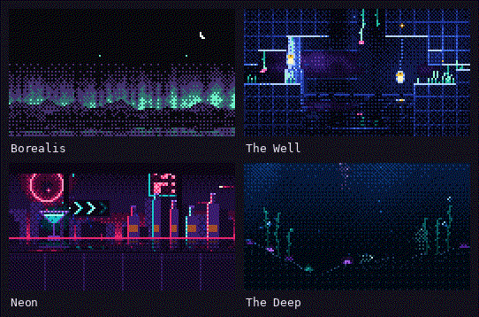

# dsh-live-pixel

[English](README.md)

一个 DeepSeek Harness 插件，通过 WebGL 实时绘制四种动态像素风景。



## 安装与使用

1. 打开 **插件 → 添加插件**，输入 `dsh-live-pixel@next` 并确认安装。选择「立即启用」，按界面提示重启。
2. 打开 **设置 → 像素主题**，选择想用的场景。如果背景让文字难以辨认，可以降低「风景强度」或提高「卡片纸色」。

从 GitHub Release 下载 tarball 后，也可在「添加插件」中输入该文件在 DSH 宿主机上的绝对路径。需要卸载时，在「插件」页打开此插件并选择「卸载」。

### 从本地版本迁移

安装前，在同一个 profile 卸载 `@local/dsh-pixel-themes`。如果旧版通过手工补丁加载，则移除对应条目。新包会沿用当前客户端已保存的偏好。

## 四种主题

| 主题 | 场景 | 明暗配色 |
| --- | --- | --- |
| **极光** | 流星划过夜幕，极光映在山间湖面。浅色模式是双色孔版印刷风格的黎明。 | 明暗两套配色 |
| **深井** | 井底吊灯、藤蔓、水面倒影和落石。 | 共用一套夜景配色 |
| **霓虹** | 酒吧临街的窗户、霓虹招牌、雨丝和酒瓶。 | 共用一套夜景配色 |
| **深海** | 深海光柱、游过的蓝鲸、水母和海草。 | 共用一套夜景配色 |

## 可读性设置

| 控件 | 默认 | 作用 |
| --- | --- | --- |
| 主题 | 极光 | 切换场景，并使用新着色器重建画布 |
| 风景强度 | 100% | 调低后会增加覆盖在风景上的纸色 |
| 卡片纸色 | 93% | 卡片、输入框、消息气泡和代码块的纸色不透明度 |
| 侧栏纸色 | 90% | 会话列表和右侧面板的纸色不透明度 |
| 底部柔光 | 60% | 输入框上方渐隐层的强度 |

每个主题独立保存滑块数值。「恢复默认」重置当前主题。偏好存于当前 Desktop 安装环境或 Web 浏览器配置中。

## 实现原理

- **共享 WebGL 引擎。** 一块固定画布（`z-index: -1`），每 3 CSS 像素绘制一个抖动格，目标帧率为 24 FPS。引擎负责尺寸、帧调度、指针缓动和 WebGL 上下文恢复。标签页隐藏时暂停动画，开启系统「减少动态效果」时显示静帧。动态风景依赖 WebGL。
- **主题数据。** 每个主题提供 GLSL 片段着色器、明暗着色器调色板、界面语义色、中英文名称与控件默认值。Bayer 矩阵由着色器选用。霓虹使用 4×4，其余场景均为 8×8。
- **界面 Token。** 语义配色与纸色不透明度共同生成 40 多个 `--dsw-alias-*` 和 `--dsw-specific-*` Token，让对话框、菜单和代码块等元素跟随主题。
- **可读层。** 样式表将 `body`、`#root`、会话列等主要容器的背景设为透明，让画布透出。`--dsw-alias-bg-base` 保持不透明以保留卡片底色，侧栏也保留自己的纸色。画布上方的覆色（`--dsh-pixel-veil`）和底部渐隐（`--dsh-pixel-scrim`）由设置页控制。

## 兼容性

Desktop 和 Web 使用同一个客户端插件。已在 DSH `0.2.2-rc.1` 的隔离 Web profile 中验证 `dsh-live-pixel@next` 的安装和卸载。Desktop 的实机安装与渲染待验证。

前面的图形界面安装步骤在两端通用。若使用命令行，请选择对应的 profile。

```sh
# Web profile
dsh plugin --profile web add dsh-live-pixel@next
# Desktop profile，使用 Desktop 自带的 dsh 命令
dsh plugin --profile desktop add dsh-live-pixel@next
```

Web 使用其他 profile 时请替换 `web`，安装后重启服务并刷新浏览器。Desktop 需先启动一次以初始化 profile，完全退出后再执行内置命令，安装后重新打开应用。[Desktop 内置命令运行时](https://github.com/deepseek-ai/deepseek-harness/blob/dsh-v0.2.2-rc.1/apps/desktop/README.zh.md#bundled-command-runtime)

## 贡献与开发

### 新增主题

1. 复制极光主题模块为 `themes/<id>.js`。调整 `id`、`label`、`description` 和 `defaults`，再替换 `fragment`、`colors` 和 `palette`。[极光主题源码](themes/borealis.js)
2. 在仓库根目录运行 `node scripts/build.mjs`。构建脚本会自动发现并校验新主题。
3. 刷新页面，在 **设置 → 像素主题** 中选中新主题。它会独立保存自己的可读性设置。

主题模块以默认导出的对象声明以下字段。

| 字段 | 说明 |
| --- | --- |
| `id` | 以字母开头、唯一的 kebab-case ID，同时用作主题偏好的存储键 |
| `label` | `zh` 与 `en` 均为非空字符串 |
| `description` | 可选，显示在下拉框下方的本地化说明 |
| `defaults` | 可选，覆盖 `scene`、`surface`、`sides` 和 `scrim` 的默认值 |
| `colors` | `light`、`dark` 声明同一组 uniform 名称和 RGB 字节三元组。两套都须包含 `uPaper`，用作画布底色和可读层的着色基准 |
| `palette` | `light`、`dark` 各自定义 UI 语义色 `paper`、`surface`、`surfaceDeep`、`ink`、`inkSoft`、`inkFaint`、`accent` 和 `accentHover`，值为 RGB 字节三元组 |
| `fragment` | 定义了 `void main()` 的 GLSL 片段着色器字符串 |

引擎提供 `uRes`、`uTime`、`uPointer` 和 `uNight`，暗色模式下 `uNight` 为 `1`。构建校验失败时会指出主题文件和字段。修改源码后运行构建命令生成客户端包。[生成的 client.js](client.js)

### 构建与测试

```sh
node scripts/build.mjs           # 生成 client.js
node scripts/build.mjs --check   # 检查生成产物是否与源码一致
node tests/smoke.mjs             # 使用 DOM、React 和 WebGL 测试桩
node tests/render.real.mjs       # 使用 React 18 和 jsdom 挂载设置页
```

- 冒烟测试运行生成的客户端包，覆盖 `<body>` 创建前启动、注入测试主题后切换并重建画布，以及卸载。React 测试桩会检查 `getSnapshot` 的引用稳定性，防止设置页陷入渲染循环。[冒烟测试](tests/smoke.mjs)
- 设置页测试通过 `react-dom/client` 挂载组件，依次从 `PIXEL_THEMES_REACT_DIR`、本包 `node_modules` 或同级工作区包中查找 React 18、`react-dom` 和 jsdom。缺少依赖时会跳过测试。设置页的错误边界会直接显示渲染异常。[React 设置页测试](tests/render.real.mjs)

在仓库根目录运行下面的命令，即可在浏览器中验证着色器和引擎。[着色器检查脚本](scripts/shader-check.mjs)

```sh
node scripts/shader-check.mjs
python3 -m http.server 8400
```

- [着色器检查页](http://127.0.0.1:8400/tests/shader-check/) 使用 GPU 编译每个着色器并渲染一帧，报告 `ok / mean / lit% / tones`。`tones` 为 1 表示整帧只使用了一个色阶，常见原因是 uniform 缺失或调色板错误。
- [引擎检查页](http://127.0.0.1:8400/tests/shader-check/boot.html?theme=well) 加载客户端包，报告画布尺寸、绘制次数、GL 错误和警告。可以在地址后加上 `&scheme=light` 检查浅色模式。
- [场景一览](http://127.0.0.1:8400/tests/shader-check/gallery.html) 同时显示四个实际渲染场景。

### 源码目录

```text
src/                 按构建顺序拼接的运行时模块
  00-runtime.js        平台引入、标识与颜色工具
  10-settings.js       控件、主题偏好与存储
  20-stage.js          WebGL 渲染和帧调度
  30-tokens.js         从主题配色生成界面 Token
  40-styles.js         背景透明与可读层
  50-section.js        设置页
  60-plugin.js         注册与生命周期
themes/              每个主题一个模块
scripts/             构建脚本和浏览器检查工具
tests/               冒烟测试和设置页渲染测试
client.js            生成的客户端包
```

## 许可与鸣谢

本项目采用 MIT 许可。极光主题的着色器移植了 Adolanium 的 hermes-borealis 场景结构和调色板。[MIT 许可证](LICENSE) · [第三方许可说明](THIRD_PARTY_NOTICES.md) · [hermes-borealis](https://github.com/Adolanium/hermes-borealis)
